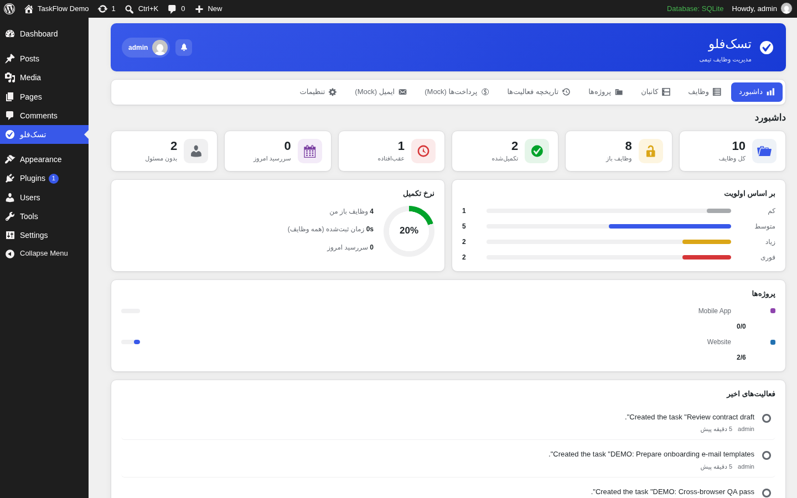
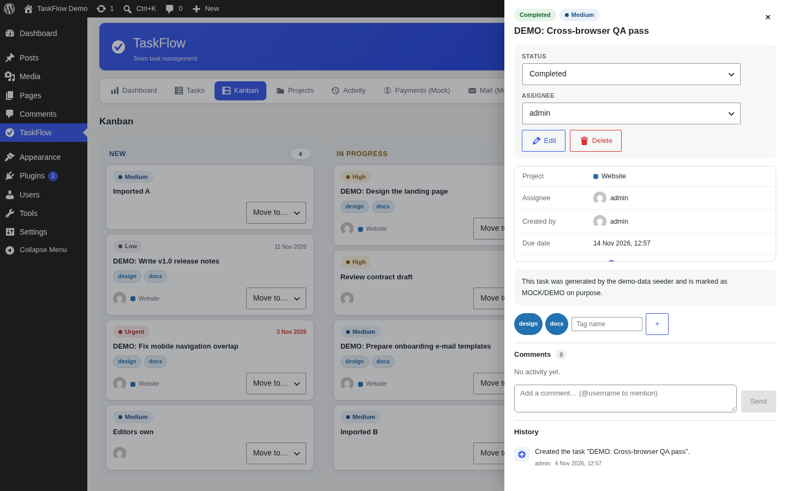

# TaskFlow – Team Task Management for WordPress

افزونهٔ مستقل مدیریت وظایف تیمی برای وردپرس — PHP + Vue.js 3 + REST API امن + MySQL (از طریق `wpdb`).
ساخته‌شده برای چالش فنی WordPress Plugin Developer شرکت US Theme (۱۴۰۵).

[](docs/TESTING.md) [](LICENSE) [](https://vuejs.org)

> **نصب سریع:** فایل `taskflow.zip` (Release) را از **Plugins → Add New → Upload Plugin** نصب کنید و منوی **TaskFlow** را در پیشخوان باز کنید. راهنمای کامل: [docs/INSTALL.md](docs/INSTALL.md)

---

## ✨ قابلیت‌ها (۱۲ الزامی + ۳ خلاقانه)

| # | قابلیت | وضعیت |
|---|---------|:-----:|
| ۰۱ | مدیریت کامل وظایف (CRUD با ذخیره‌سازی پایدار MySQL) | ✅ |
| ۰۲ | جزئیات و وضعیت وظیفه (عنوان، توضیحات، اولویت، سررسید، جدید/در حال انجام/تکمیل‌شده) | ✅ |
| ۰۳ | پروژه‌ها و برچسب‌ها + ارتباط وظیفه با هر دو | ✅ |
| ۰۴ | تخصیص وظیفه به کاربران وردپرس | ✅ |
| ۰۵ | سطوح دسترسی نقش‌محور + مالکیت (کنترل کامل سمت سرور) | ✅ |
| ۰۶ | جستجوی عنوان + فیلتر وضعیت/اولویت/مسئول/پروژه/برچسب + مرتب‌سازی | ✅ |
| ۰۷ | نمای فهرست و Kanban با جابه‌جایی Drag & Drop | ✅ |
| ۰۸ | تاریخچهٔ فعالیت‌ها (ایجاد، ویرایش، تغییر مسئول، تغییر وضعیت + زمان و کاربر) | ✅ |
| ۰۹ | داشبورد آماری زنده (باز، تکمیل‌شده، عقب‌افتاده، نرخ تکمیل، توزیع اولویت و پروژه) | ✅ |
| ۱۰ | اعلان درون‌افزونه‌ای + شبیه‌سازی ایمیل (Outbox/Inbox با گزارش رویدادها) | ✅ |
| ۱۱ | درگاه پرداخت Mock (success / failed / pending + نهایی‌سازی) | ✅ |
| ۱۲ | تنظیمات، خروجی CSV/JSON، رفتار مستندشدهٔ حذف افزونه | ✅ |
| ★ | **خلاقانه ۱:** نظرات روی وظیفه با @منشن و اعلان | ✅ |
| ★ | **خلاقانه ۲:** تایمر ثبت زمان کار (Start/Stop + گزارش) | ✅ |
| ★ | **خلاقانه ۳:** ورود گروهی وظایف از CSV با قالب آماده | ✅ |

سناریوی پذیرش هر قابلیت: [docs/ACCEPTANCE.md](docs/ACCEPTANCE.md)

## 📸 اسکرین‌شات‌ها

| داشبورد | Kanban |
|---------|--------|
|  |  |

سایر نماها: [فهرست وظایف](docs/screenshots/tasks-list.png) · [جزئیات وظیفه](docs/screenshots/task-drawer.png) · [پروژه‌ها](docs/screenshots/projects.png) · [پرداخت Mock](docs/screenshots/mock-payments.png) · [ایمیل Mock](docs/screenshots/mock-mail.png) · [تنظیمات](docs/screenshots/settings.png) · [تاریخچه](docs/screenshots/activity.png) · [داشبورد EN](docs/screenshots/dashboard.png) · [فهرست RTL](docs/screenshots/tasks-fa-rtl.png)

## 🔐 امنیت

- REST API وردپرس با **`permission_callback` روی تک‌تک مسیرها** (قابلیت + مالکیت)
- احراز هویت کوکی + **Nonce** (`X-WP-Nonce`) برای همهٔ درخواست‌های SPA
- پاکسازی/اعتبارسنجی ورودی‌ها، Escape خروجی‌ها، **`$wpdb->prepare()`** در تمام کوئری‌ها
- ORDER BY فقط از ستون‌های whitelist؛ `IN (...)` با placeholder تولیدشده از شمارش آرگومان‌ها
- Control سطح دسترسی: `taskflow_manage` / `taskflow_edit_others_tasks` / `taskflow_edit_tasks` + قاعدهٔ مالکیت (ایجادکننده و مسئول همیشه به وظیفهٔ خود دسترسی دارند)
- هیچ رمز، Token یا Secret در مخزن ثبت نشده است

## 🏗 معماری

لایه‌بندی ماژولار با جداسازی کامل منطق وظایف / ذخیره‌سازی / API / سرویس‌های Mock — تعویض Mock با سرویس واقعی فقط با جایگزینی Adapter انجام می‌شود:

```
REST Controllers  →  Services (منطق کسب‌وکار)  →  Repositories (SQL خالص)  →  wpdb/MySQL
       ↑                                                        ↓
  Vue.js 3 SPA  ←  taskflow/v1 REST  ←  Mock Adapters (Payment / Mail)
```

جزئیات کامل، مدل داده و فلسفهٔ طراحی: [docs/ARCHITECTURE.md](docs/ARCHITECTURE.md)

## 🧪 تست‌ها

- **۶۱ تست / ۲۱۳ اظهار PHPUnit** روی CRUD، مجوزها، جست‌وجو/فیلتر، Kanban، داشبورد، Mock پرداخت، Mock ایمیل، ایمپورت/اکسپورت، نظرات و تایمر — همه سبز ✅
- **۵۶ بررسی End-to-End** روی وردپرس واقعی (REST + مجوزها + جریان کامل) — همه سبز ✅ و `debug.log` بدون هیچ هشدار PHP
- اجرا بدون نیاز به وردپرس یا MySQL: `php phpunit.phar -c phpunit.xml.dist` — راهنما و نتایج: [docs/TESTING.md](docs/TESTING.md)

## 🌐 دوزبانه و RTL

- همهٔ رشته‌ها با توابع استاندارد i18n وردپرس؛ ترجمهٔ کامل فارسی (`fa_IR`) داخل بسته
- در پیشخوان فارسی، کل رابط به‌صورت خودکار **RTL** می‌شود (CSS Logical Properties)
- تاریخ‌ها در زبان فارسی با تقویم هجری شمسی نمایش داده می‌شوند

## 📦 نیازمندی‌ها و نسخه‌ها

| فناوری | نسخهٔ آزمایش‌شده | حداقل |
|--------|------------------|-------|
| WordPress | 6.9 (sqlite-database-integration 2.1.15) | 6.0 |
| PHP | 8.3.32 | 7.4 |
| MySQL / MariaDB | هر نسخهٔ سازگار با وردپرس (تست روی SQLite drop-in) | MySQL 5.7+ / MariaDB 10.3+ |
| Vue.js | 3.5.13 (bundled — بدون نیاز به Build) | 3.x |

افزونه از قالب مستقل است و به Zephyr/Impreza یا افزونهٔ دیگری وابسته نیست.

## 🚀 ساختار مخزن

```
taskflow.php                 بوت‌لودر افزونه + autoloader
uninstall.php                حذف انتخابی داده‌ها (طبق تنظیمات)
includes/                    ۲۶ کلاس PHP (Schema, Repositories, Services, REST, Mocks…)
templates/                   قالب‌های x-template برنامهٔ Vue
assets/js/                   ماژول‌های Vue 3 (بدون Build – vue.global.prod.js داخل بسته)
assets/css/taskflow.css      استایل کامل SPA (RTL-aware)
assets/vendor/               vue.global.prod.js 3.5.13
languages/                   taskflow.pot + fa_IR (po/mo)
tests/                       PHPUnit + bootstrap مستقل (SQLite shim)
docs/                        معماری، نصب، تست، پذیرش، گزارش نهایی، اسکرین‌شات‌ها
.github/workflows/ci.yml     CI: PHP-Lint + PHPUnit روی push/PR
```

## 📄 لایسنس

GPL-2.0-or-later — سازگار با وردپرس. [متن کامل](LICENSE)

---

### English summary

TaskFlow is a standalone WordPress task-management plugin (PHP 7.4+ / Vue 3 / secure REST API / custom tables via `wpdb`). It ships the 12 required features of the assessment plus 3 creative extensions (comments with @mentions, time tracking, CSV import), a fully translated RTL-ready bilingual UI, a mock payment gateway and a mock mailer (both clearly labeled MOCK/DEMO), 61 PHPUnit tests + 56 live end-to-end checks, and complete docs (architecture, install, testing, acceptance scenarios). Install via **Plugins → Add New → Upload**, open the **TaskFlow** menu. Licensed GPL-2.0-or-later.
